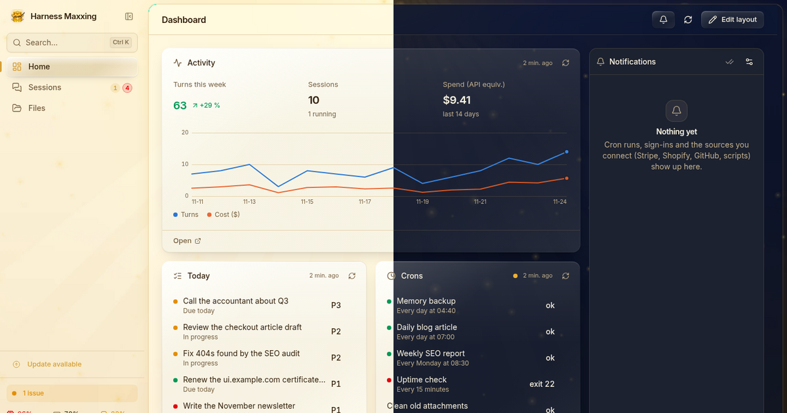

# Paladin, a Harness Maxxing theme

Holy light for Harness Maxxing: ivory and gold by day, a sacred night of deep blue and gold after dark.

- **Glass** theme with an animated sky: rays of light breathing from above and motes of gold rising slowly
  (an animated WebP wallpaper, no script).
- Light mode in ivory and gold, dark mode in night blue and gold.
- Gilded main buttons with a sheen that sweeps across on hover.
- A halo of holy light on every click, fading out like a heal, and a golden glow on cards and buttons on hover.
- A golden knight as logo (sidebar, phone header, dialogs, browser tab).

## Install

Ask Harness in any session: "install the theme `paladin` from Community", then pick **Paladin** in
Settings -> Appearance -> Theme.

The gilded buttons and the light effects live in the theme's advanced CSS: Harness switches it off by itself after an update that changes
the interface, until it has been checked again. Everything else (colors, animated sky, logo) always works. With "reduce motion" on, the transitions are off.

---

# Paladin, un thème Harness Maxxing

Lumière sacrée : ivoire et or le jour, nuit sacrée bleu profond et or le soir. Thème Glass avec un ciel animé (rayons qui
respirent, particules de lumière qui montent), boutons dorés avec un reflet au survol, halo de lumière à chaque clic,
un chevalier doré pour logo.
